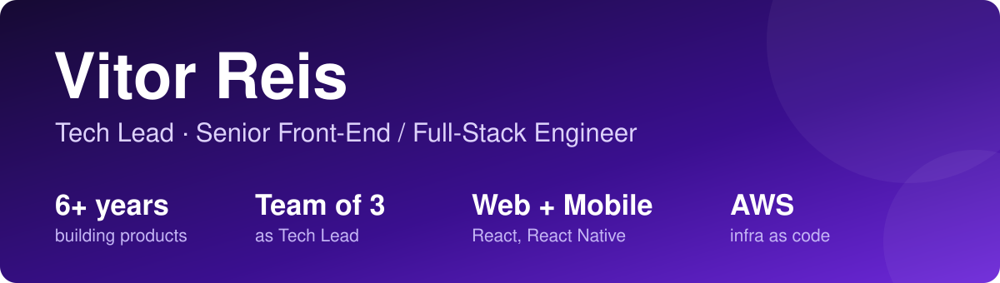

  
  
  

| Area | Stack |
|---|---|
| **Front-end** Complex React apps, offline PWAs |  |
| **Mobile** Published on App Store and Google Play |   |
| **Back-end** REST APIs, auth, payments |  |
| **Data** Relational, NoSQL, cache |  |
| **Cloud & DevOps** AWS CDK, CI/CD, cost tuning |  |
| **Observability** Traces, metrics, dashboards |   |
| **Testing** Unit to end-to-end |   |
| **Applied AI** Agents, MCP, OCR + LLM pipelines |  |
| **Working knowledge** |  |
